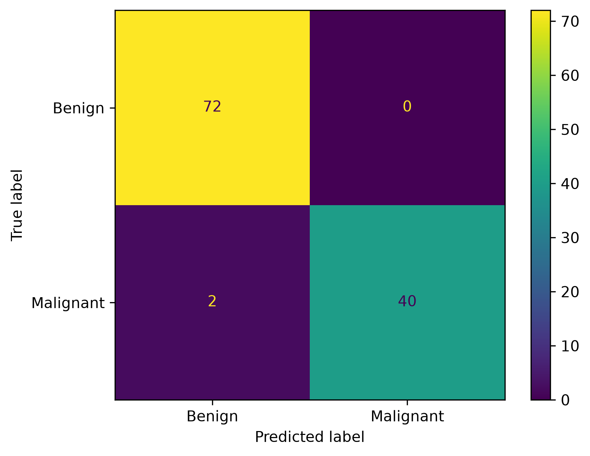
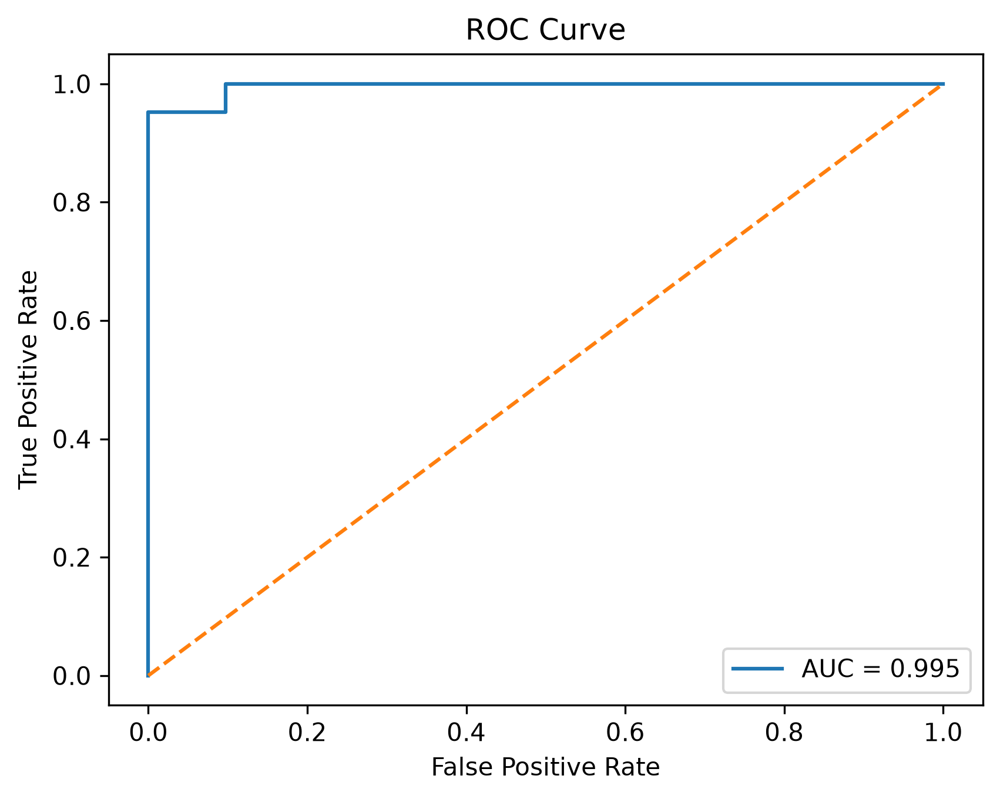

# Breast Cancer Classification using Logistic Regression

A concise machine learning pipeline to classify breast cancer tumors as **Malignant** or **Benign** using Logistic Regression.

## 📂 Dataset
- **Input:** `data.csv`
- **Target Variable:** `diagnosis` (Mapped: `M` = 1, `B` = 0)

## How to Run
1. Ensure `data.csv` is in the same directory.
2. Install dependencies:
   ```bash
   pip install pandas scikit-learn matplotlib
   ```
3. Run the script:
   ```bash
   python main.py
   ```

## Evaluation Scores

| Metric | Score |
| :--- | :--- |
| **Precision** | 1.0 |
| **Recall** | 0.95 |
| **ROC AUC** | 0.99 |

## Visualizations

### Confusion Matrix


### ROC Curve

